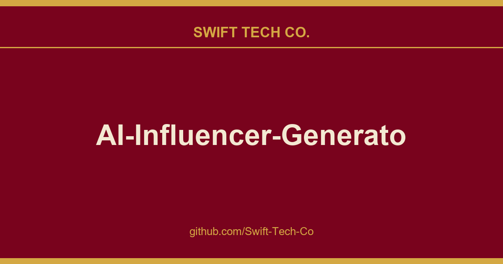

# AI-Influencer-Generator

## What This Is

This is part of the Swift Tech Co. working stack for product and engineering. It gathers the AI-Influencer-Generator notes, examples and fixes that keep delivery fast, and doubles as the reference map we hand to whoever picks up this thread next.

## Images

[](https://github.com/Swift-Tech-Co/AI-Influencer-Generator)

## Related Projects

- MuAPI  Unified API for image, video, and audio generation across hundreds of AI models. Explore the image and video playground and access keys.
- Free-AI-Social-Media-Scheduler  Schedule your AI influencer content across all social platforms automatically
- Open-AI-UGC  Generate AI UGC video ads with realistic AI actors
- Open-Generative-AI  Free open-source studio for 200+ AI image & video models
- ai-creator-academy  free curriculum teaching creators how to monetize AI influencer content
- AI-Youtube-Shorts-Generator  Generate YouTube Shorts automatically
- AI-Faceless-Video-Generator  Create talking face videos
- Text-To-Video-AI  Text to video generation

## Tutorial

Read the full guide: AI Influencer Automation to Earn $10K/Month

## Demo

https://github.com/Swift-Tech-Co/AI-Influencer-Generator

## Features

- **AI Image Generation** - Create unique influencer personas with Stable Diffusion
- **Text-to-Speech** - Generate natural voiceovers with gTTS
- **Lip Sync Animation** - Bring images to life with SadTalker
- **Consistent Characters** - Maintain the same AI persona across content
- **Fully Open Source** - No paid APIs required for core functionality

## How It Works

```
Prompt → Stable Diffusion Image → gTTS Audio → SadTalker Video → AI Influencer Content
```

1. **Design Your Persona** - Use AI to generate consistent character images
2. **Create Scripts** - Write or generate content for your influencer
3. **Generate Voice** - Convert scripts to speech with text-to-speech
4. **Animate** - Use lip-sync technology to create talking videos
5. **Publish** - Post content to social media platforms

## Quick Start

### Option 1: Google Colab (Recommended)

[](https://github.com/Swift-Tech-Co/AI-Influencer-Generator)

1. Open the notebook in Google Colab
2. Run each cell sequentially
3. Customize your AI influencer
4. Download your generated content

### Option 2: Local Setup

```bash
# Clone the repository
git clone https://github.com/Swift-Tech-Co/AI-Influencer-Generator
cd AI-Influencer-Generator

# Install dependencies
pip install -r requirements.txt

# Run the notebook
jupyter notebook AI_Influencer.ipynb
```

## Tech Stack

| Technology | Purpose |
|------------|---------|
| Stable Diffusion | AI image generation |
| gTTS | Text-to-speech |
| SadTalker | Lip-sync animation |
| OpenAI GPT | Prompt generation |

## Use Cases

- **Brand Ambassadors** - Create virtual product representatives
- **Educational Content** - AI tutors and presenters
- **Entertainment** - Virtual characters and personas

## Tips for Success

1. **Consistency** - Use similar prompts to maintain character appearance
2. **Quality Audio** - Clear scripts produce better lip-sync results
3. **Lighting** - Generated images with good lighting animate better
4. **Resolution** - Higher resolution images produce better videos

## Contributing

Contributions are welcome! Feel free to submit a Pull Request.

If you enjoy using AI Influencer, please give us a star to show your support!

## Follow for Updates

- Anil Chandra Naidu Matcha
- Ankur Singh

## License

MIT License - see [LICENSE](LICENSE) for details.

---

## Swift Tech Co.

Built and maintained by Swift Tech Co.

AI Automation | FinTech Platforms | Custom Software and Mobile Apps | SaaS Platforms | Cloud Infrastructure | Cybersecurity | SEO and Marketing | API Integration

**Join our community on Telegram:** [t.me/+Qt_eFvkb2rliMzNh](https://t.me/+Qt_eFvkb2rliMzNh)

Home | Services | Careers | Referral Program | Influencers | About | Contact

**Connect**

- Website: https://github.com/Swift-Tech-Co/AI-Influencer-Generator
- LinkedIn: [linkedin.com/in/stephenoladoke](https://www.linkedin.com/in/stephenoladoke/)
- LinkedIn (Company): [linkedin.com/company/swift-tech-co](https://www.linkedin.com/company/swift-tech-co)
- X: [@MrOladoke](https://x.com/MrOladoke)
- Instagram: [@mr.oladoke](https://www.instagram.com/mr.oladoke/)
- Organization: [github.com/Swift-Tech-Co](https://github.com/Swift-Tech-Co)

## Sources

Compiled and maintained from upstream [SamurAIGPT/AI-Influencer-Generator](https://github.com/SamurAIGPT/AI-Influencer-Generator) under permissive open-source license.

---

Maintained by [Swift Tech Co.](https://github.com/Swift-Tech-Co) - [Telegram](https://t.me/+Qt_eFvkb2rliMzNh)

## Sources

Compiled and maintained from upstream [SamurAIGPT/AI-Influencer-Generator](https://github.com/SamurAIGPT/AI-Influencer-Generator) under permissive open-source license.

---

Maintained by [Swift Tech Co.](https://github.com/Swift-Tech-Co) - [Telegram](https://t.me/+Qt_eFvkb2rliMzNh)

## Sources

Compiled and maintained from upstream [SamurAIGPT/AI-Influencer-Generator](https://github.com/SamurAIGPT/AI-Influencer-Generator) under permissive open-source license.

---

Maintained by [Swift Tech Co.](https://github.com/Swift-Tech-Co) - [Telegram](https://t.me/+Qt_eFvkb2rliMzNh)

## Sources

Compiled and maintained from upstream [SamurAIGPT/AI-Influencer-Generator](https://github.com/SamurAIGPT/AI-Influencer-Generator) under permissive open-source license.

---

Maintained by [Swift Tech Co.](https://github.com/Swift-Tech-Co) - [Telegram](https://t.me/+Qt_eFvkb2rliMzNh)

## Sources

Compiled and maintained from upstream [SamurAIGPT/AI-Influencer-Generator](https://github.com/SamurAIGPT/AI-Influencer-Generator) under permissive open-source license.

---

Maintained by [Swift Tech Co.](https://github.com/Swift-Tech-Co) - [Telegram](https://t.me/+Qt_eFvkb2rliMzNh)